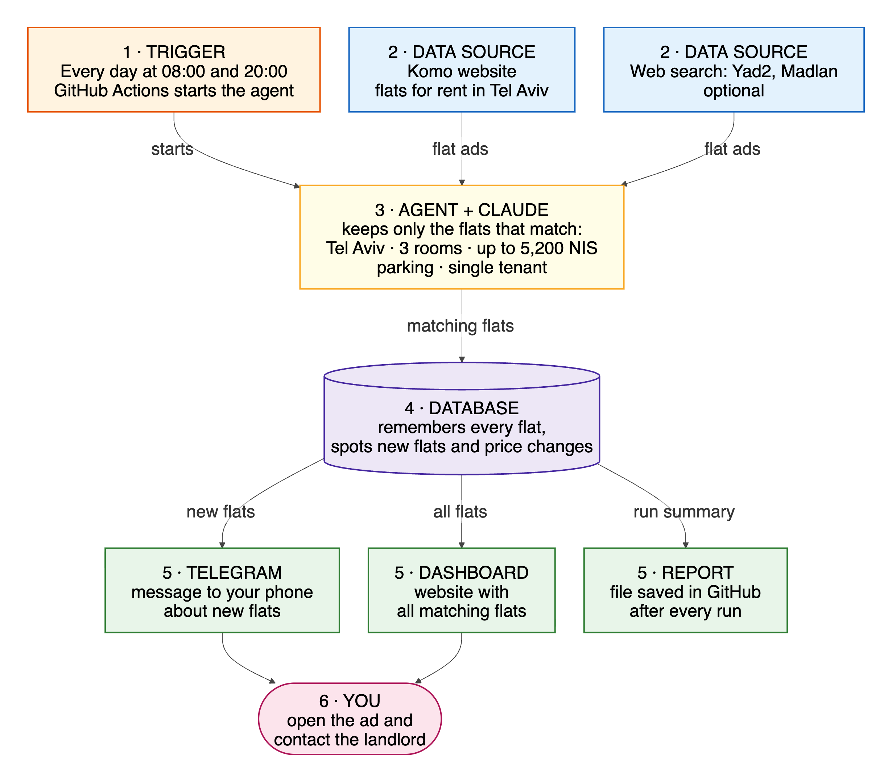
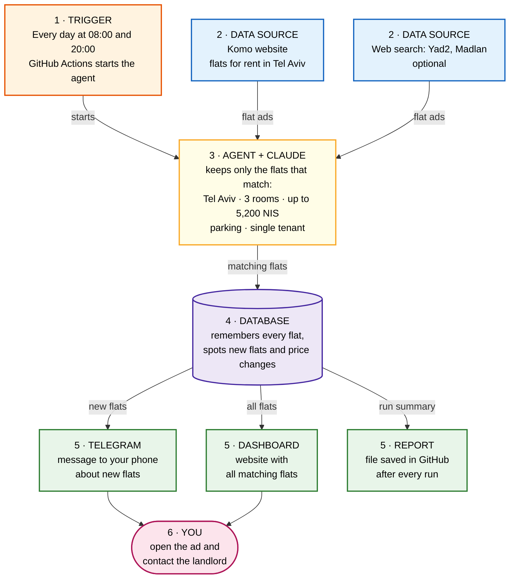
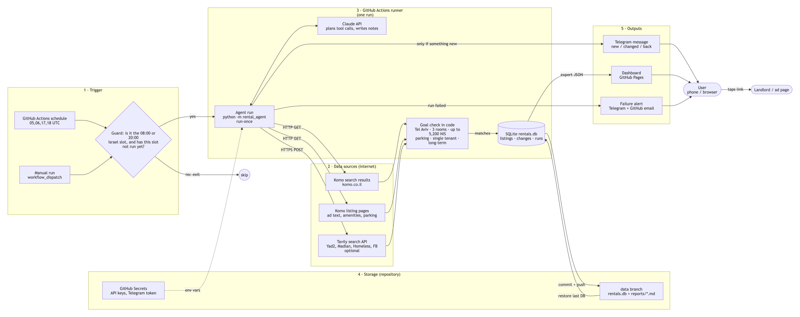
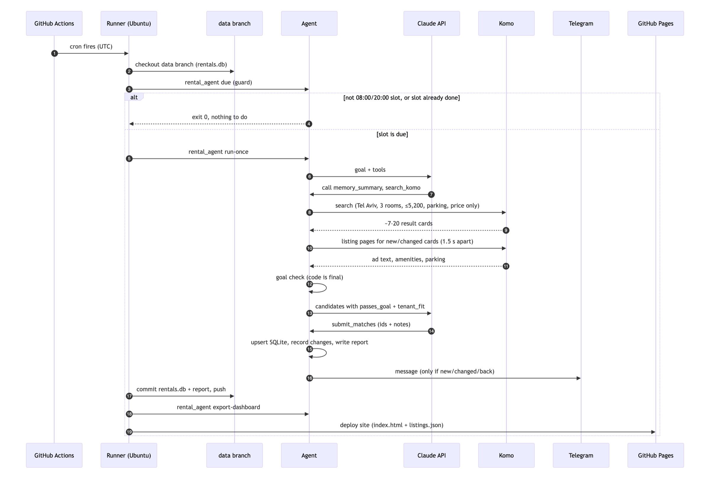
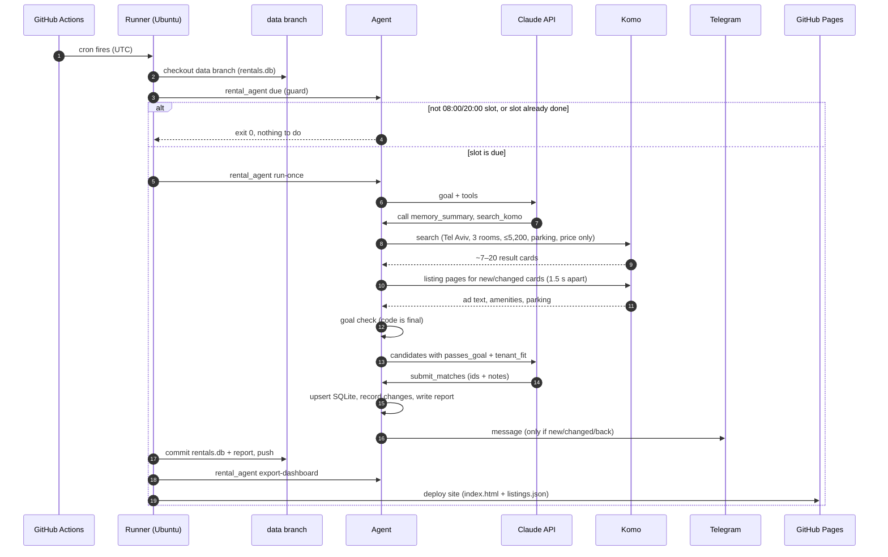
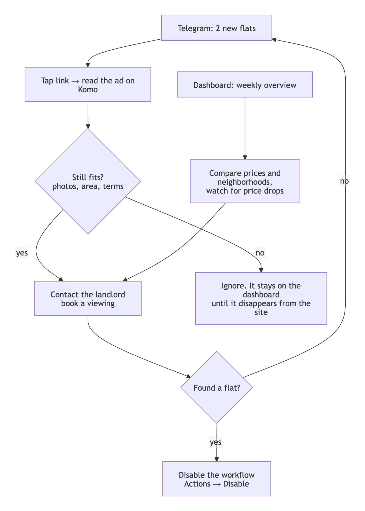
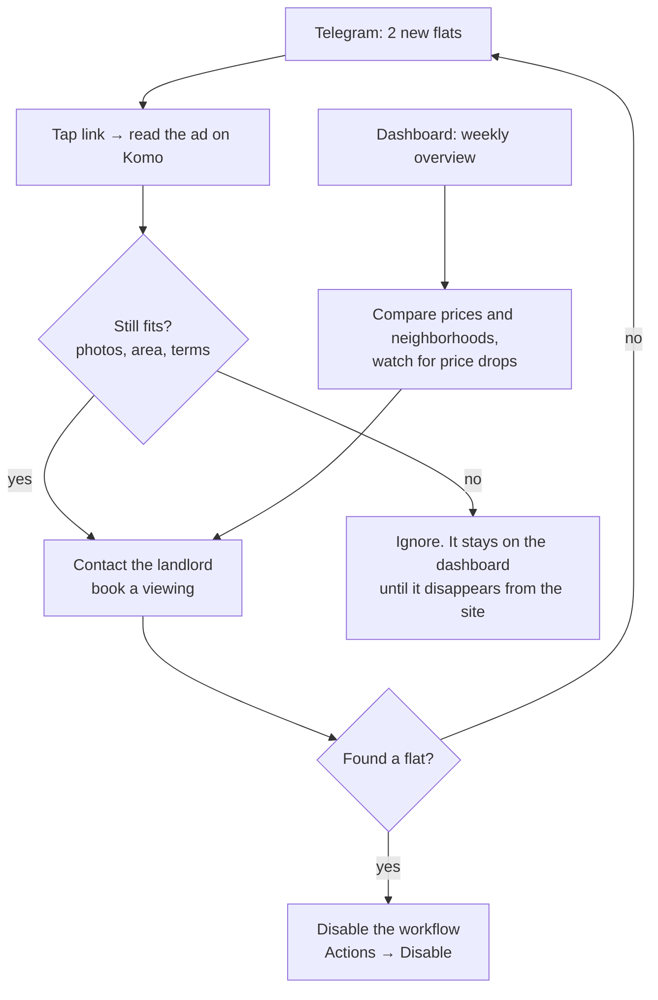

# Architecture — Tel Aviv Rental Agent in production

Last updated 2026-10-16. **Status: running.** The workflow is live, and the dashboard is at **https://niritlib-debug.github.io/tel-aviv-rental-agent/**.

This document describes how the agent runs unattended: what triggers it, where its data comes from, where its output goes, and how a person uses the results. Requirements and the inside of a single run are in [SPEC.md](SPEC.md).

**Status legend:** ✅ built, tested and running · 🔑 built, needs a secret to switch on

## 1. Summary

| Question | Answer |
|---|---|
| **Where does it run?** | GitHub Actions, in this repository (free for public repositories, no server to maintain). |
| **What triggers it?** | A scheduled workflow, twice a day at 08:00 and 20:00 Israel time. It can also be started by hand with the "Run workflow" button. |
| **Where does the data come from?** | Komo search results and listing pages (verified source), optional Tavily web search (Yad2, Madlan, Homeless, Facebook), and the agent's own memory of past runs. |
| **Where is the data kept?** | A SQLite database (`rentals.db`), saved after every run to a separate `data` branch of the repository. |
| **Where does the output go?** | 1) A Telegram message to the user's phone when there are new or changed flats. 2) A dashboard web page (GitHub Pages) with every current match. 3) A Markdown report per run, kept in the `data` branch. |
| **What does the user do with it?** | Opens the Telegram message, taps the link to the ad, reads it, and contacts the landlord. Uses the dashboard to compare flats and see price history. |

## 2. System data flow

### At a glance

Read it from top to bottom: what starts the agent and where the data comes from (1–2), what the agent does with it (3–4), where the results are sent (5), and what you do with them (6).

Diagram source (Mermaid)

### Detailed view

The same flow with every component: where data originates (left), how the agent processes it (middle), and where it is sent (right).

Diagram source (Mermaid)

## 3. One scheduled run, step by step

Diagram source (Mermaid)

## 4. Components

### 4.1 Trigger — GitHub Actions schedule ✅

GitHub's `schedule` trigger only understands UTC and can start a few minutes late. Israel switches between UTC+3 (summer) and UTC+2 (winter), so one UTC time can't always mean 08:00 in Israel. The design fires four times a day and lets a guard decide:

| UTC trigger | Summer (IDT) | Winter (IST) | Result |
|---|---|---|---|
| 05:00 | 08:00 ✔ run | 07:00 | outside window → skip |
| 06:00 | 09:00 | 08:00 ✔ run | summer: slot already done → skip |
| 17:00 | 20:00 ✔ run | 19:00 | outside window → skip |
| 18:00 | 21:00 | 20:00 ✔ run | summer: slot already done → skip |

(Times checked with Python's `zoneinfo` for 15 July and 15 January 2026.)

**Guard rule** (`python -m rental_agent due`, ✅): run only if the current Israel time is within 2 hours after a configured slot (08:00 or 20:00) **and** the `runs` table has no successful run for that slot today. The 2-hour window absorbs GitHub's start delays; the `runs` check stops the second trigger from running the same slot twice. A manual run (`workflow_dispatch`) skips the guard.

The workflow is [`.github/workflows/agent.yml`](.github/workflows/agent.yml). Its steps:

1. Check out `main` (code) and the `data` branch into `./data` (memory).
2. `python -m rental_agent due`: the guard. It prints `run=true/false` and the slot id, and passes them to later steps through `GITHUB_OUTPUT`. A manual run is always due.
3. `python -m rental_agent run-once --slot <id>`: the agent, with API keys from GitHub Secrets. It is marked `continue-on-error`, so a failed run is still saved and shown on the dashboard.
4. Commit `rentals.db` and `reports/` to the `data` branch and push.
5. `python -m rental_agent export-dashboard --out site`, then upload it as the Pages artifact.
6. If the agent run failed, the job fails at the very end, and GitHub emails the repository owner.
7. A second job, `deploy`, publishes the artifact to GitHub Pages.

Settings for this environment are in [`deploy/github-actions.toml`](deploy/github-actions.toml): the same goal, with the database and reports stored under `./data`. The `concurrency` group guarantees that two runs never overlap.

The agent already supports a long-running scheduler (`python -m rental_agent schedule`, ✅), which uses the Israel time zone directly. That mode is the choice for an always-on machine (§7).

### 4.2 Agent run ✅

Built and tested (154 tests). One run does: plan with Claude → search Komo → read listing pages → optional web search → goal check in code → save to SQLite → report → notify. Details: SPEC.md §4–§5.

Claude is optional. Without `ANTHROPIC_API_KEY`, or if the API fails, the same run continues in deterministic mode, so a Claude outage never means a missed search.

### 4.3 Database — SQLite on the `data` branch ✅

| Table | One row per | Used for |
|---|---|---|
| `listings` | flat ever matched | dedup, `first_seen` / `last_seen`, stale flag, tenant classification, ad text, parking |
| `listing_changes` | field change | price history, tenant-classification changes |
| `runs` | run | audit log; `slot` column for the guard ("has this slot run?"); failure alert; dashboard health panel |

A GitHub Actions runner starts empty every time, so the database must be saved somewhere between runs. Options considered:

| Option | Survives | Verdict |
|---|---|---|
| Actions cache | evicted after 7 days without use, or when space runs out | ✗ can lose memory |
| Workflow artifact | expires (90 days by default) and is awkward to restore | ✗ |
| **Orphan `data` branch in this repo** | permanent; every run is a commit, so any old state can be restored | ✔ chosen |
| Hosted database (e.g. Postgres) | permanent | over-sized for ~100 rows a month |

The [`data` branch](https://github.com/niritlib-debug/tel-aviv-rental-agent/tree/data) holds only `rentals.db` and `reports/`. Before the database is committed, SQLite's write-ahead log is folded into the main file, so `rentals.db` alone is a complete copy. Keeping it apart from `main` keeps the code history clean. The database stays small (a few hundred KB per year).

### 4.4 Outputs

| Output | Content | When | Status |
|---|---|---|---|
| **Console log** | full report | every run (visible in the Actions log) | ✅ |
| **Markdown report** `reports/<date>_<time>_run<N>.md` | New / Changed / Back / Still available, with links and notes | every run, committed to `data` | ✅ |
| **Telegram message** | only new, changed (e.g. price drop) and reappeared flats, each with its link | only when there is something new, so no messages on quiet runs | 🔑 `TELEGRAM_BOT_TOKEN`, `TELEGRAM_CHAT_ID` |
| **Dashboard** (GitHub Pages) | see §4.5 | rebuilt after every run | ✅ |
| **Failure alert** | Telegram: "the last 2 runs failed" with the reason, then "recovered" when a run succeeds again (no repeats while it keeps failing). GitHub also emails the repo owner whenever the job fails. | 2nd failed run in a row | ✅ email · 🔑 Telegram |

### 4.5 Dashboard ✅

**https://niritlib-debug.github.io/tel-aviv-rental-agent/** — a static page published with GitHub Pages: no server, no login, nothing to keep running. After each run, `python -m rental_agent export-dashboard` writes:

- `site/listings.json`: active matches, with price history from `listing_changes`
- `site/runs.json`: the last 30 runs
- `site/index.html`: one page that reads both files

What the page shows:

| Panel | Content |
|---|---|
| Header | "Last successful run: 16 Oct 21:57". Turns red if older than 13 hours, meaning a run was missed. |
| Matches table | address, neighborhood, price, size, floor, tags (parking, suits a single tenant, unverified), first seen, link. Sortable by price or date, filter by neighborhood. |
| New since last visit | a counter and a filter button for flats first seen after the browser's last visit (remembered locally in the browser). |
| Price history | one line per flat whose price changed, with drops in green and rises in red. |
| Run health | last 30 runs: status, mode (Claude / deterministic), matches, new, errors. |

## 5. What the user does with the output

Diagram source (Mermaid)

The agent never contacts landlords and never fills in forms. A person makes every decision about an ad.

## 6. Reliability, security and cost

| Concern | Design |
|---|---|
| **Missed runs** | 2-hour guard window; dashboard header turns red after 13 h; Telegram alert after two failed runs. |
| **Double runs** | `concurrency` group in the workflow plus a per-slot check in the `runs` table. |
| **A source is down** | Run is marked `partial` and continues with the other sources (SPEC §8). |
| **Claude down or refuses** | Automatic fallback to deterministic mode for that run. |
| **Site blocks or asks for login** | Agent stops for that source; it never bypasses bot protection or logs in. |
| **Secrets** | Only in GitHub Secrets → environment variables. Never in code, config files, logs or the `data` branch. |
| **Privacy** | The repository is public, so the `data` branch and the dashboard are public too. They contain only public ad information, but they do show what you are looking for. To keep them private, make the repository private: Pages on private repositories needs a paid GitHub plan, so the dashboard would then be downloaded as an artifact instead. |
| **Load on Komo** | 1 search page + only the listing pages that are new or changed (usually 0–7) per run, 1.5 s apart, honest User-Agent, robots.txt respected. |
| **Cost** | GitHub Actions and Pages are free for public repositories. Tavily has a free tier. Claude: a few API calls per run at low effort; set a monthly spend limit in the Claude Console. |

## 7. Alternative platforms

| Platform | Trigger | Where SQLite lives | Good for | Trade-off |
|---|---|---|---|---|
| **GitHub Actions** (chosen) | `schedule` cron + guard | `data` branch | free, nothing to maintain, code and runs in one place | UTC-only cron, start delays (handled by the guard) |
| Always-on machine (small cloud VM, Raspberry Pi, home server) | built-in `python -m rental_agent schedule` (✅ works today) under systemd | local disk | simplest code path, real Israel-time scheduling | someone keeps the machine running and updated |
| Cloud cron service (e.g. Render or Railway cron jobs) | platform cron | attached volume | managed, logs included | usually paid; volume setup |
| No-code automation (e.g. Make or n8n) | scenario schedule → calls the GitHub workflow (`workflow_dispatch`) | unchanged (`data` branch) | course-friendly visual trigger, easy extra outputs (email, Google Sheets) | another account and connection to maintain |

Moving between platforms changes only the trigger and where `rentals.db` is stored. The agent code is the same.

## 8. Build status

| Step | Status |
|---|---|
| `python -m rental_agent due` guard + `runs.slot` (schema v4), tested for summer, winter, late starts, retries after a failed slot and windows that cross midnight | ✅ |
| `.github/workflows/agent.yml` + orphan `data` branch | ✅ |
| `python -m rental_agent export-dashboard` + GitHub Pages (source: GitHub Actions) | ✅ |
| Failure alert (2nd failed run in a row → Telegram; recovery message) | ✅ |
| Verified on GitHub (16 Oct 2026): run 1 found 4 flats and committed `reports/…_run1.md`; run 2 reported 0 new / 4 still available, so memory carried over between runners; the dashboard serves the 4 flats | ✅ |
| Add repository secrets (**Settings → Secrets and variables → Actions**): `ANTHROPIC_API_KEY` (Claude mode), `TAVILY_API_KEY` (web search), `TELEGRAM_BOT_TOKEN` + `TELEGRAM_CHAT_ID` (messages and alerts). Without them the workflow already runs in deterministic mode with Komo only. | 🔑 owner |
