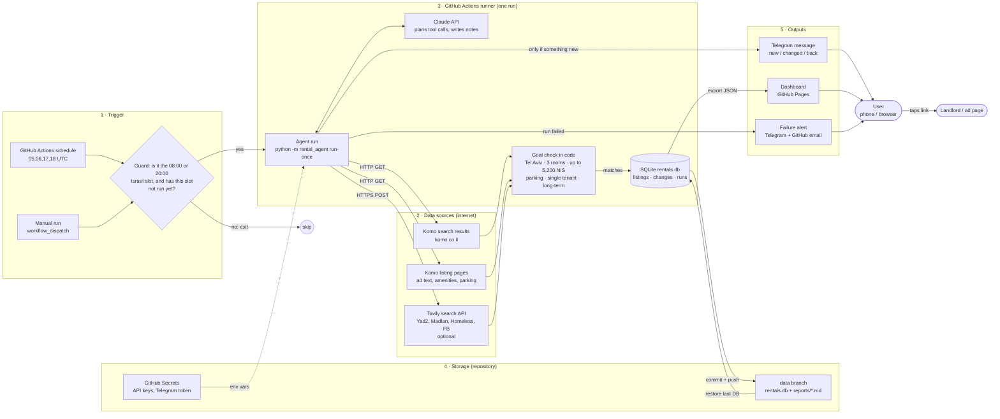
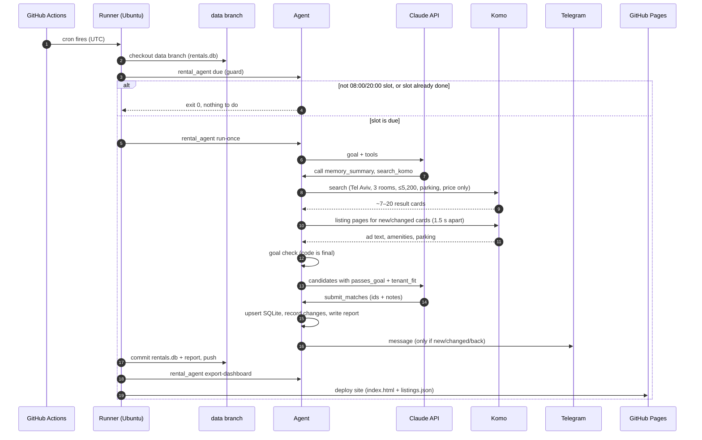
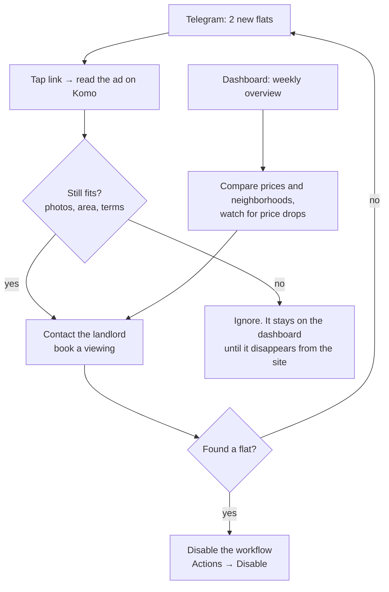

# Architecture — Tel Aviv Rental Agent in production

Last updated 2026-10-16. This document describes how the agent runs unattended: what triggers it, where its data comes from, where its output goes, and how a person uses the results. Requirements and the inside of a single run are in [SPEC.md](SPEC.md).

**Status legend:** ✅ built and tested · 🛠 planned (designed here, not built yet)

## 1. Summary

| Question | Answer |
|---|---|
| **Where does it run?** | GitHub Actions, in this repository (free for public repositories, no server to maintain). |
| **What triggers it?** | A scheduled workflow, twice a day at 08:00 and 20:00 Israel time. It can also be started by hand with the "Run workflow" button. |
| **Where does the data come from?** | Komo search results and listing pages (verified source), optional Tavily web search (Yad2, Madlan, Homeless, Facebook), and the agent's own memory of past runs. |
| **Where is the data kept?** | A SQLite database (`rentals.db`), saved after every run to a separate `data` branch of the repository. |
| **Where does the output go?** | 1) A Telegram message to the user's phone when there are new or changed flats. 2) A dashboard web page (GitHub Pages) with every current match. 3) A Markdown report per run, kept in the `data` branch. |
| **What does the user do with it?** | Opens the Telegram message, taps the link to the ad, reads it, and contacts the landlord. Uses the dashboard to compare flats and see price history. |

## 2. System data flow

Where data originates (left), how the agent processes it (middle), and where it is sent (right).



## 3. One scheduled run, step by step



## 4. Components

### 4.1 Trigger — GitHub Actions schedule 🛠

GitHub's `schedule` trigger only understands UTC and can start a few minutes late. Israel switches between UTC+3 (summer) and UTC+2 (winter), so one UTC time can't always mean 08:00 in Israel. The design fires four times a day and lets a guard decide:

| UTC trigger | Summer (IDT) | Winter (IST) | Result |
|---|---|---|---|
| 05:00 | 08:00 ✔ run | 07:00 | outside window → skip |
| 06:00 | 09:00 | 08:00 ✔ run | summer: slot already done → skip |
| 17:00 | 20:00 ✔ run | 19:00 | outside window → skip |
| 18:00 | 21:00 | 20:00 ✔ run | summer: slot already done → skip |

(Times checked with Python's `zoneinfo` for 15 July and 15 January 2026.)

**Guard rule** (`python -m rental_agent due`, 🛠): run only if the current Israel time is within 2 hours after a configured slot (08:00 or 20:00) **and** the `runs` table has no successful run for that slot today. The 2-hour window absorbs GitHub's start delays; the `runs` check stops the second trigger from running the same slot twice. A manual run (`workflow_dispatch`) skips the guard.

Planned workflow `.github/workflows/agent.yml`:

```yaml
name: rental-agent
on:
  schedule:
    - cron: "0 5,6,17,18 * * *"   # UTC; the guard picks the real 08:00/20:00 Israel slot
  workflow_dispatch: {}            # "Run workflow" button
concurrency: { group: rental-agent, cancel-in-progress: false }   # never two runs at once
permissions: { contents: write, pages: write, id-token: write }
jobs:
  run:
    runs-on: ubuntu-latest
    timeout-minutes: 15
    steps:
      - uses: actions/checkout@v4
      - uses: actions/checkout@v4          # state lives on the data branch
        with: { ref: data, path: data }
      - uses: actions/setup-python@v5
        with: { python-version: "3.12" }
      - run: pip install .
      - id: due
        run: python -m rental_agent due --manual=${{ github.event_name == 'workflow_dispatch' }}
      - if: steps.due.outputs.run == 'true'
        run: python -m rental_agent run-once
        env:
          ANTHROPIC_API_KEY: ${{ secrets.ANTHROPIC_API_KEY }}
          TAVILY_API_KEY: ${{ secrets.TAVILY_API_KEY }}
          TELEGRAM_BOT_TOKEN: ${{ secrets.TELEGRAM_BOT_TOKEN }}
          TELEGRAM_CHAT_ID: ${{ secrets.TELEGRAM_CHAT_ID }}
      - if: steps.due.outputs.run == 'true'
        run: |                              # save memory for the next run
          cd data && git add rentals.db reports && git -c user.name=rental-agent \
            -c user.email=rental-agent@users.noreply.github.com commit -m "run $(date -u +%FT%TZ)" && git push
      - if: steps.due.outputs.run == 'true'
        run: python -m rental_agent export-dashboard --out site
      # then actions/upload-pages-artifact + actions/deploy-pages
```

The agent already supports a long-running scheduler (`python -m rental_agent schedule`, ✅), which uses the Israel time zone directly. That mode is the choice for an always-on machine (§7).

### 4.2 Agent run ✅

Already built and tested (137 tests). One run does: plan with Claude → search Komo → read listing pages → optional web search → goal check in code → save to SQLite → report → notify. Details: SPEC.md §4–§5.

Claude is optional. Without `ANTHROPIC_API_KEY`, or if the API fails, the same run continues in deterministic mode, so a Claude outage never means a missed search.

### 4.3 Database — SQLite ✅ (storage on the `data` branch 🛠)

| Table | One row per | Used for |
|---|---|---|
| `listings` | flat ever matched | dedup, `first_seen` / `last_seen`, stale flag, tenant classification, ad text, parking |
| `listing_changes` | field change | price history, tenant-classification changes |
| `runs` | run | audit log, guard ("has this slot run?"), dashboard health panel |

A GitHub Actions runner starts empty every time, so the database must be saved somewhere between runs. Options considered:

| Option | Survives | Verdict |
|---|---|---|
| Actions cache | evicted after 7 days without use, or when space runs out | ✗ can lose memory |
| Workflow artifact | expires (90 days by default) and is awkward to restore | ✗ |
| **Orphan `data` branch in this repo** | permanent; every run is a commit, so any old state can be restored | ✔ chosen |
| Hosted database (e.g. Postgres) | permanent | over-sized for ~100 rows a month |

The `data` branch holds only `rentals.db` and `reports/`. Keeping it apart from `main` keeps the code history clean. The database stays small (a few hundred KB per year).

### 4.4 Outputs

| Output | Content | When | Status |
|---|---|---|---|
| **Console log** | full report | every run (visible in the Actions log) | ✅ |
| **Markdown report** `reports/<date>_<time>_run<N>.md` | New / Changed / Back / Still available, with links and notes | every run, committed to `data` | ✅ file · 🛠 commit |
| **Telegram message** | only new, changed (e.g. price drop) and reappeared flats, each with its link | only when there is something new, so no messages on quiet runs | ✅ (needs bot token) |
| **Dashboard** (GitHub Pages) | see §4.5 | rebuilt after every run | 🛠 |
| **Failure alert** | "run failed: <reason>" via Telegram; GitHub also emails the repo owner when a workflow fails | when `runs.status = failed` twice in a row | 🛠 |

### 4.5 Dashboard 🛠

A static page published with GitHub Pages: no server, no login, nothing to keep running. After each run, `python -m rental_agent export-dashboard` writes:

- `site/listings.json`: active matches, with price history from `listing_changes`
- `site/runs.json`: the last 30 runs
- `site/index.html`: one page that reads both files

What the page shows:

| Panel | Content |
|---|---|
| Header | "Last successful run: 16 Oct 20:00". Turns red if older than 13 hours, meaning a run was missed. |
| Matches table | address, neighborhood, price, size, floor, tags (parking, suits a single tenant, unverified), first seen, link. Sortable by price or date, filter by neighborhood. |
| New since last visit | rows first seen after the browser's last visit (remembered locally in the browser). |
| Price history | small line per flat when its price changed. |
| Run health | last 30 runs: status, mode (Claude / deterministic), matches, new, errors. |

## 5. What the user does with the output



The agent never contacts landlords and never fills in forms. A person makes every decision about an ad.

## 6. Reliability, security and cost

| Concern | Design |
|---|---|
| **Missed runs** | 2-hour guard window; dashboard header turns red after 13 h; Telegram alert after two failed runs. |
| **Double runs** | `concurrency` group in the workflow plus a per-slot check in the `runs` table. |
| **A source is down** | Run is marked `partial` and continues with the other sources (SPEC §8). |
| **Claude down or refuses** | Automatic fallback to deterministic mode for that run. |
| **Site blocks or asks for login** | Agent stops for that source; it never bypasses bot protection or logs in. |
| **Secrets** | Only in GitHub Secrets → environment variables. Never in code, config files, logs or the `data` branch. |
| **Privacy** | The repository is public, so the `data` branch and the dashboard are public too. They contain only public ad information, but they do show what you are looking for. To keep them private, make the repository private: Pages on private repositories needs a paid GitHub plan, so the dashboard would then be downloaded as an artifact instead. |
| **Load on Komo** | 1 search page + only the listing pages that are new or changed (usually 0–7) per run, 1.5 s apart, honest User-Agent, robots.txt respected. |
| **Cost** | GitHub Actions and Pages are free for public repositories. Tavily has a free tier. Claude: a few API calls per run at low effort; set a monthly spend limit in the Claude Console. |

## 7. Alternative platforms

| Platform | Trigger | Where SQLite lives | Good for | Trade-off |
|---|---|---|---|---|
| **GitHub Actions** (chosen) | `schedule` cron + guard | `data` branch | free, nothing to maintain, code and runs in one place | UTC-only cron, start delays (handled by the guard) |
| Always-on machine (small cloud VM, Raspberry Pi, home server) | built-in `python -m rental_agent schedule` (✅ works today) under systemd | local disk | simplest code path, real Israel-time scheduling | someone keeps the machine running and updated |
| Cloud cron service (e.g. Render or Railway cron jobs) | platform cron | attached volume | managed, logs included | usually paid; volume setup |
| No-code automation (e.g. Make or n8n) | scenario schedule → calls the GitHub workflow (`workflow_dispatch`) | unchanged (`data` branch) | course-friendly visual trigger, easy extra outputs (email, Google Sheets) | another account and connection to maintain |

Moving between platforms changes only the trigger and where `rentals.db` is stored. The agent code is the same.

## 8. Build plan for the 🛠 parts

1. `python -m rental_agent due`: guard command + slot tracking in `runs` (with tests for both seasons and late starts).
2. `.github/workflows/agent.yml` + create the orphan `data` branch.
3. `python -m rental_agent export-dashboard` + static `index.html`; enable GitHub Pages (source: GitHub Actions).
4. Failure alert (two failed runs in a row → Telegram).
5. Add the four repository secrets and run once manually from the Actions tab.
